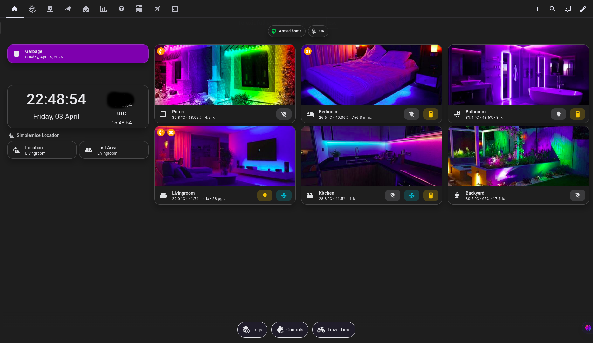
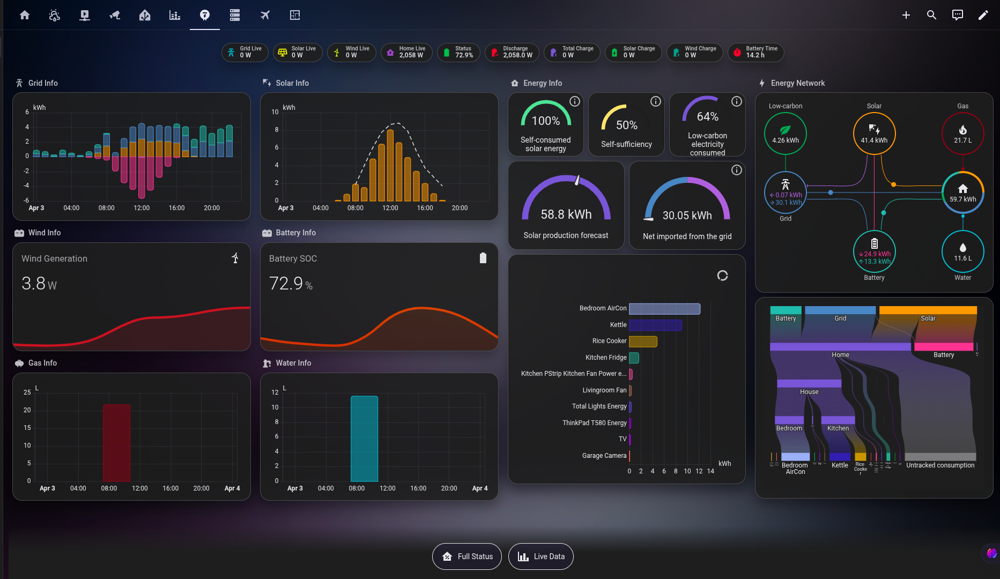

  

<h1 align="center">
  Casa de Rattón 🏠🐭  
   
  Home Assistant Configuration  
   
  (Testing Instance with Fully Realistic Simulation Packages)
</h1>

  
  
  
  
  
  
  

---

# Casa De Ratton is not just automated technology.   It is a living system designed to assist without demanding attention.

---

Like all other Home Assistant instances this is also a Work in Progress :D

---

## ⚠️ PLEASE READ [License](https://github.com/simplemice/home_assistant/blob/main/LICENSE)

## ⚠️ PLEASE READ [Documentation](https://github.com/simplemice/home_assistant/blob/main/docs/README.md)

---

## ⚖️ Casa de Rattón's Three Laws of Home Automation

When designing Casa de Rattón's automations I have made every effort to prioritize the solution based on the following three laws. 

### 🥇 First Law
**Every automation or action should be the result of a passive sensor or indirect action**.

### 🥈 Second Law
**An automation can be triggered by voice command only when Law 1 cannot be achieved**.

### 🥉 Third Law
**An automation or action can be trigger by a physical switch or as the result of a direct iteraction only when Law 1 and Law 2 cannot be achieved.**

---

## 📸 Screenshots

  
Some screenshots about test instalation

   

    
  <b>Main Window</b>

    

    
  <b>Energy Window</b>

This repo contains the tested, working [Home Assistant](https://home-assistant.io/) configuration for **Casa de Rattón**. Below are links to the devices currently being used, blog posts, and other HA enthusists that provided inspiration and configs to help build this config.

---

## 🤝 Contributions

This is primarily a private configuration project. External inspiration is welcome, but direct pull requests may not be accepted unless aligned with Casa de Rattón architecture principles.

---

# 📦 GitHub Repository Information

This repository serves as the **central backup, testing, and release source** for the Casa de Rattón Home Assistant environment.

---

## 🎯 Repository Purpose

- Maintain a fully working Home Assistant configuration  
- Provide reproducible testing environment packages  
- Track configuration evolution via Git history  
- Publish tagged releases for stable configuration snapshots  
- Serve as disaster recovery backup  

---

## 🌿 Branch Strategy

- `main` — active live configuration and development  
- tagged releases (`v*`) — stable snapshots used for restore or deployment  

---

## 🚀 Releases & Packages

Each tagged release contains:

- validated configuration state  
- automation and script updates  
- simulation package changes  
- compatibility adjustments for new Home Assistant versions  

Releases are automatically generated using GitHub Actions workflows after version tagging.

---

## 💾 Backup Philosophy

This repository is treated as:

- configuration source of truth  
- versioned automation history  
- rapid recovery mechanism  
- experimentation sandbox without risking production stability  

---

# 📊 Some statistics about Test Installation

| Description | value |
|------------|------|
| Number of entities | 2612 |
| Number of sensors | 1459 |
| Current Version | 2026.11.0 |
| Total Automations | 133 |
| Total Scripts | 45 |
| Total Lights | 36 |
| Total Switches | 197 |
| Total Scenes | 6 |
| Total Players | 26 |

---

## 🧩 Add-ons

- Advanced SSH & Web Terminal

- Home Assistant MCP Server (Dev)

- Matter Server

- Matterbridge

- Network UPS Tools

- openWakeWord

- Piper

- Samba share

- Silero TTS Enhanced Engine

- Studio Code Server

- Whisper

## 🧩 Installed Integrations
- [Adaptive Cover Pro](https://github.com/jrhubott/adaptive-cover-pro) (v2026.10.0)
- [Adaptive Lighting](https://github.com/basnijholt/adaptive-lighting#readme) (v1.30.1)
- [AI Memory](https://github.com/Riscue/ha-ai-memory) (v0.4.0)
- [Alarmo](https://github.com/nielsfaber/alarmo) (v1.10.17)
- [AstroWeather](https://github.com/mawinkler/astroweather) (v0.75.0)
- [Bermuda BLE Trilateration](https://github.com/agittins/bermuda) (v0.8.5)
- [Browser mod](https://github.com/thomasloven/hass-browser_mod/blob/master/README.md) (v2.12.0)
- [Claude Pulse](https://github.com/nikolmedo/ClaudePulse) (v1.2.0)
- [Cloudflare Speed Test](https://github.com/DigitallyRefined/ha-cloudflare-speed-test) (v0.0.14)
- [Entity Availability](https://github.com/italo-lombardi/Home-Assistant-EntityAvailability) (v0.7.0)
- [Flightradar24](https://github.com/AlexandrErohin/home-assistant-flightradar24) (vv2.4.1)
- [Fontawesome icons](https://github.com/thomasloven/hass-fontawesome) (v2.3.0)
- [Frigate](https://github.com/blakeblackshear/frigate) (v5.15.6)
- [Generate readme](https://github.com/custom-components/readme) (v0.5.0)
- [HA-MCP Custom Component](https://github.com/homeassistant-ai/ha-mcp) (v9.1.0)
- [HyperHDR](https://github.com/Shaffer-Softworks/hyperhdr-ha#readme) (v0.10.5)
- [LEX TH Parcel Tracking](https://lex.th/tracking) (v0.3.1)
- [LLM Vision](https://llmvision.gitbook.io/getting-started/) (v1.7.1)
- [MikroTik Extended](https://github.com/Csontikka/ha-mikrotik-extended) (v0.14.0)
- [Multiscrape](https://github.com/danieldotnl/ha-multiscrape) (v8.0.2)
- [Music Assistant Jukebox](https://github.com/DJS91/HAMusicAssistantJukebox) (v0.1.0)
- [NOAA Space Weather](https://github.com/tcarwash/home-assistant_noaa-space-weather) (v2.0.5)
- [Passive BLE monitor](https://github.com/custom-components/ble_monitor) (v13.12.0)
- [Pirate Weather](https://github.com/alexander0042/pirate-weather-ha) (v1.8.9)
- [Powercalc](https://docs.powercalc.nl) (vv1.20.14)
- [Proxmox VE](https://github.com/dougiteixeira/proxmoxve) (v4.0.2)
- [Silero TTS Enhanced](https://github.com/indevor/silero-tts-enhanced-hacs) (v1.0.2)
- [Simulated Inverter](https://github.com/simplemice/home_assistant) (v1.0.1)
- [SmartIR](https://github.com/smartHomeHub/SmartIR) (v1.18.1)
- [Spook](https://spook.boo) (v5.11.1)
- [Sun2](https://github.com/pnbruckner/ha-sun2/blob/3.4.3/README.md) (v3.4.3)
- [Thailand Weather Alerts (TMD)](https://github.com/simplemice/tmd_alerts) (v2.3.2)
- [Thermal Comfort](https://github.com/dolezsa/thermal_comfort/blob/master/README.md) (v3.1.0)
- [Ventilation Assistant](https://github.com/derabbink/ha_hacs_ventilation_assistant) (v1.2.0)
- [X11 Smartlock Local BLE](https://github.com/asemenov566/tuya_smartlock_local_ble) (v0.1.0)
- [Xiaomi Gateway 3](https://github.com/AlexxIT/XiaomiGateway3) (v4.1.4)
- [Xiaomi Miot](https://github.com/al-one/hass-xiaomi-miot) (v1.1.4)
- [Zambretti and Sager](https://github.com/ziffmafiya/zambretti_sager) (v1.9.93)

## 🔗 Custom integrations

## 🎛️ Lovelace plugins

## 🎨 Themes

---

## 📜 License & Credits

Copyright @2026  
[Nightdestiny Group](https://nightdestiny.com)  
[Casa De Ratton](https://social.nightdestiny.com/@house)

---

🛠️ This README.md generated automaticaly after each git update, by the  
[custom readme integration](https://github.com/custom-components/readme)