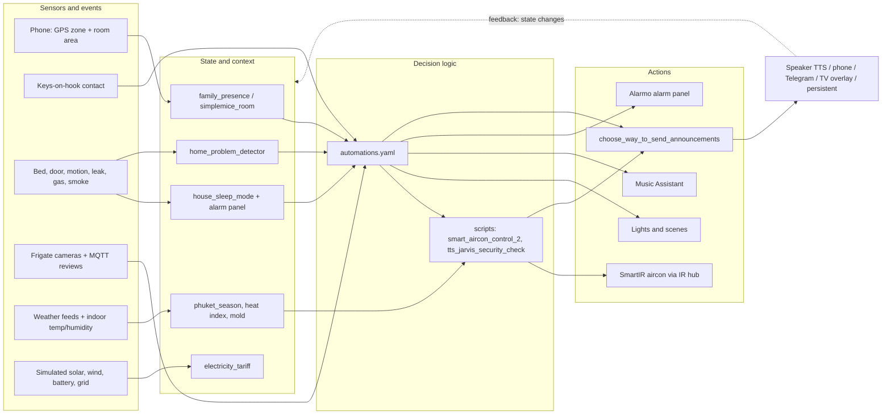

# 🏠 Casa De Ratton — Fully Automated Smart Home

---

## What This Is

Casa De Ratton is a fully autonomous smart home running on Home Assistant. It manages presence, climate, security, energy, media, and social automation without manual input. An AI persona named **JARVIS** handles all voice announcements and notifications, routing them to the right output — speaker, phone, Telegram, TV, or the HA notification centre — based on time, context, and occupancy state.

> **Where the logic lives.** This repository tracks `configuration.yaml`, `packages/`, `template/`, `shell_commands/`, `blueprints/`, `scenes.yaml` and the voice-intent files. **`automations.yaml` and `scripts.yaml` are git-ignored** (see `.gitignore`), as are `zones.yaml`, `secrets.yaml` and `customize/`. Most of the behaviour described below (arrival/departure, wake-up, climate decisions, the notification router, security analysis) is implemented in those two ignored files, so it is not visible in the repository itself. The last documentation review (2026-10-25) verified it by reading the live files read-only; nothing was executed or changed.

---

## Architecture at a Glance

Data flows left to right: devices and external feeds produce raw states, template sensors and helpers (mostly in `packages/`) turn them into house-level context, automations decide, and scripts or direct service calls act. **Every spoken or written message funnels through a single script**, `script.choose_way_to_send_announcements`, which is why the notification section below matters for almost every subsystem.

---

## How It Works

**🚶 Presence & Arrival**

`binary_sensor.family_presence` (`packages/presense.yaml`) is the house's "someone is home" signal. It is true when a `person` entity is `home`/`house` **or** the phone reports a known room (`sensor.micemob_area`), so it keeps working when GPS and Wi‑Fi disagree. `sensor.simplemice_room` and `sensor.simplemice_location` turn the phone's room/zone into friendly text ("Sleep", "At Work", "At Food Store", or the room).

Departure and arrival are not purely GPS-based. The **keys-on-hook contact** (`binary_sensor.wall_house_keys_contact`) is a key input:

- **Leaving:** when `family_presence` has been off for 3 minutes and the keys are on the hook (and HA has been up for 5+ minutes), the house stamps `input_datetime.simplemice_left_home_at`, arms the alarm in *away* mode, and switches off the aircon, kettle, fans, all lights, and the laptop, and turns off audible and climate-automation toggles. An AI-generated JARVIS departure message follows.
- **Returning:** two automations. *Welcome & Media* fires when the keys are taken off the hook after more than 5 minutes away, records `simplemice_return_home_at`, gathers house status (air quality, UPS, battery, backup age, away duration), asks the AI for a personalised welcome, sends it through the router, and starts the TV box. *Lights and Climate* fires 18 minutes after the person leaves a work location (only after 21:00, not in guest or cleaning mode), starts the aircon, sets the alarm to *armed home*, turns the fans on and runs the living-room scene.

Room-level tracking drives speaker routing: `sensor.current_music_speaker` (`packages/media.yaml`) maps the phone's room to the nearest speaker, falling back to the living room. BLE-based room detection (Bermuda) is installed; the YAML only consumes the resulting area sensor.

---

**🌅 Morning Wake-Up**

Two automations split the morning:

1. **Morning Music WakeUp** fires at `input_datetime.mice_wakeup_alarm_time` — only if the bedroom door is closed, someone is home, and sleep mode is on. It waits (up to 30 s) for the bedroom Chromecast to be ready, then starts a shuffled Music Assistant playlist and ramps the volume up over 5 minutes via `script.smooth_volume_increase`.
2. **Morning Wakeup - Transfer Setup** fires when the bedroom door opens after the alarm time and the bed is empty. It waits for the phone to appear in the living room, sets the alarm to *armed home*, ends sleep mode, re-enables audible and Telegram notifications, runs the living-room scene, turns on fans, kettle and display, and plays the JARVIS **morning briefing** (`script.morning_report_announce`, in `packages/announces.yaml`) through the router.

Going to bed is the mirror image: **Sleep Automation** triggers when the bed has been occupied for 30 seconds between 20:00 and 05:00 with the bedroom door closed and the living-room fan running. It arms the alarm in *night* mode, stops media, turns off lights, fans, kettle and display, mutes audible notifications, switches sleep mode on and calls the aircon controller. A **Good Night Announcement** fires at `input_datetime.mice_sleep_time`.

---

**🌡️ Climate**

Aircon control (a SmartIR climate entity driven by an IR hub, `packages/climate.yaml`) is delegated to a single script, **`script.smart_aircon_control_2`**. It reads `sensor.phuket_season`, the bedroom heat index and humidity, and picks *cool*, *dry* or *off*:

| Season value | Cool when heat index ≥ | Dry when humidity ≥ | Dry heat-index window | Dry setpoint |
|---|---|---|---|---|
| `Hot Season` | 29 | 75 % | 26–32 | 27 °C |
| any other value | 27 | 68 % | 24–30 | 28 °C |

Cool setpoint is 26 °C unless a caller overrides it. Callers:

- **Bedroom Night Climate Automation** — 20:00–08:10 with the bedroom door closed, reacting to heat index, humidity, mold indicator, and a forced off at 08:05.
- **House Climate Control Automation** — every 10 minutes while `input_boolean.climate_automation` is on, someone is home and the living room is hot (heat index > 30 and humidex > 35); also turns the aircon off in daytime once the bedroom is below 27 °C.
- **Sleep** and **Home Return** call it directly.

`sensor.phuket_season` (`packages/weather_alerts.yaml`) has **four** values, not two: *High Season* (Nov–Mar), *Hot Season* (Apr to mid‑May), *Wet Season*, and *Monsoon Peak* (Sep–Oct). Only `Hot Season` currently changes the aircon thresholds — see the discrepancy list at the end.

Runtime is tracked (`sensor.ac_runtime_today`, from power draw with a climate-state fallback) with monthly utility meters. Mold indicators, VPD, heat index, rain prediction and wind classification are derived in `packages/weather_alerts.yaml` from the local sensors and Pirate Weather / AstroWeather.

---

**💡 Lighting**

Lights adapt to presence, TV state, time and weather. Adaptive Lighting handles colour temperature; `input_boolean.adaptive_lights_mode` switches it off for the porch and bathroom lights when enabled. Living-room scenes (`livingroom_sunset`, `livingroom_purple_blue`, `livingroom_zen_garden`, `livingroom_rain_scene`) are scripts. **Livingroom TV Scene Automation** watches the TV box's active app: streaming apps switch to the movie scene, music apps to zen, and TV off restores *sunset* (05:00–18:00) or *purple/blue* (evening). Outdoor, porch, backyard and bedroom motion lights, kitchen ambient lights and the camera night lights have their own sun/motion automations. Light groups (`packages/lights.yaml`) are the shared targets.

---

**🔒 Security**

[Frigate NVR](https://frigate.video/) runs on a Proxmox LXC (with a Coral TPU, per the repository badge) and publishes review events over MQTT. The **Multi-Security Notify - JARVIS** automation is the single notifier for Frigate reviews and garage/porch motion: it captures snapshots at detection time, has LLM Vision describe the event, rates its importance, and sends one enriched notification (snapshot plus *View Clip* / *View Snapshot* buttons) through the router.

The **alarm** is Alarmo (`alarm_control_panel.home`), armed away on departure, night at bedtime, and home on return/wake-up. **Security Check On Alarm** runs `script.tts_jarvis_security_check` when `binary_sensor.home_problem_detector` (water leak, smoke, gas, aircon leak sensors, `packages/security.yaml`) has been on for 30 seconds, or the alarm panel goes to *triggered* — unless `input_boolean.alarm_pause_mode` is on (a watchdog automation warns if it is left on). The script analyses the **garage and backyard** camera snapshots with LLM Vision, posts them to Telegram, then speaks a combined report of motion, door, leak and gas sensor state. It also rings the gateway siren when appropriate and flashes lights when the house is empty and the alarm is triggered.

A **Security Daily Summary** runs 5 minutes before the configured goodnight time (with a 01:00 fallback), feeds the last 24 hours of Frigate events (`sensor.frigate_daily_report_data`) to Google AI, and posts a JARVIS-style report to the Telegram log channel; a **Weekly Security Rollup** follows the same pattern. Door contacts add a "left open for 5 minutes" reminder (suppressed in cleaning mode).

---

**🔔 Notifications**

Every message goes through `script.choose_way_to_send_announcements`, which fans out in parallel to the channels enabled by helper toggles (`packages/notify.yaml`):

- **Speaker (TTS)** — when `audible_notifications` is on **and sleep mode is off**, or when the caller sets `urgent`. The speech engine (`script.tts_jarvis_speech_engine`) picks the speaker from `sensor.current_music_speaker` (or the whole-house group for `scope: house`), sets volume by time of day (`notify_low_volume` 23:00–07:00, `notify_high_volume` otherwise), speaks via the TTS engine selected in `input_select.jarvis_pipeline`, and then restores the previous volume. Music pause/resume around announcements is not done in this script; it relies on Music Assistant's announcement handling.
- **Phone** — mobile app push when `text_notifications` is on, with optional image and action buttons.
- **Telegram** — photo or message to the log channel when `telegram_notifications` is on.
- **TV overlay** — when `tv_notifications` is on.
- **Persistent** — HA notification centre when `persistent_notifications` is on.

The **Awtrix** LED display is *not* part of the router: weather, rain forecast, now-playing, laundry timer and battery apps are driven by their own automations built from the blueprints in `blueprints/automation/homeassistant/`. **Mastodon** posts use a separate script (`mastodon_send`) and its own toggle. The five router toggles are collected in `group.notification_group`.

---

**🎵 Media**

[Music Assistant](https://music-assistant.io/) manages the speakers as a multiroom system. **Follow Me Music** (when `follow_me_music` is on and someone is home) reacts to `sensor.simplemice_room` changing to the kitchen, living room or bedroom, unjoins the house group and transfers the Music Assistant queue to that room's player; a second automation hands music between the living room and the phone. Voice intents (`custom_sentences/en/reports.yaml` and `packages/conversation.yaml`) cover "play music" (plays a playlist on the speaker nearest the phone), weather, traffic and water-tank level. The morning wake-up and the TV-driven scenes are the main automated media sequences. Several voice-music packages are disabled (`*.DISABLED`).

---

**🚿 Bathroom**

`packages/bathroom_light.yaml` runs a session per visit. Door opening or motion starts a session and turns on the light. After 5 minutes a 10-minute timer starts; at 15 minutes total the light flashes and **stays red** as a visual warning (there is no spoken or pushed alert). The session ends when the door has been closed for 10 seconds, or after 6 minutes without motion, which turns the light off and cancels both timers.

---

**🍳 Kitchen**

Kitchen timers use Home Assistant's timers and voice intents, with a *Kitchen Timers Finished* notification on completion. Kettle, rice-cooker (keep-warm, reheat) and air-fryer scripts and notifications cover appliances. A load cell under the LPG cylinder feeds `packages/gas_usage.yaml` (level %, consumption rate, days remaining, cost), and **Kitchen Gas Low Alert** announces when the cylinder drops below 5 % (not while sleep mode is on). Water tank level, flow and cost are tracked in `packages/water_usage.yaml`, with a TDS high alert. (`packages/kitchen.yaml.DISABLED` is not loaded.)

---

**🍽️ Meals**

`packages/mealie.yaml` polls Mealie's *today* meal-plan endpoint hourly and exposes today's recipe name and id. Notification automations announce the planner status. Tomorrow's plan is not exposed by this package.

---

**🧺 Laundry**

Laundry is calendar- and zone-driven. A *Laundry Day* calendar trigger announces and sets the helper; entering one of three laundry zones while `laundry_helper` is on records the zone and starts a 2-hour timer. When the timer finishes a pick-up reminder is sent (with an Awtrix indicator), and *Laundry Pickup Completed* closes the cycle when the person returns to that zone. The zones themselves are defined in `zones.yaml`, which is not in the repository.

---

**🛠️ Utility Tracking**

Background trackers for things outside the house: days since pest control (`packages/pest_service.yaml`), aircon and fan cleaning countdowns with reminders (`packages/aircon_fans_cleaning.yaml`), internet outage start/end/duration (Internet Down/Restored automations with `packages/internet_checker.yaml` helpers), cheapest 91/95 fuel price across PTT, BCP and Shell (`packages/gasoline_data.yaml`, via web scraping), and the live position of the ISS (`packages/space.yaml`, republished over MQTT as a device tracker).

---

**⚡ Energy**

The energy system is a **full simulation**, not metering. `packages/powercalc.yaml` estimates household load (`sensor.sim_home_power`) from Powercalc device profiles. Solar (3 kW array driven by sun elevation and cloud cover), a wind turbine (driven by wind speed and storm/thunder scoring), a battery (SOC from integrated charge/discharge) and the grid are modelled in `solar_simulation.yaml`, `wind_turbine_simulation.yaml`, `battery_simulation.yaml` and `grid_simulation.yaml`. Priority is: solar and wind to home, surplus to battery (3 kW cap), then export; **grid import is the residual** the other sources do not cover, and grid export is the residual generation left over.

Tariffs (`packages/enegry_tarif.yaml`): `sensor.electricity_tariff` is *peak* on weekdays 09:00–22:00 and *offpeak* otherwise, with rates in `input_number` helpers. Grid import utility meters (daily, monthly, yearly) are split into peak/offpeak, and cost, export revenue and net cost sensors are derived from them. Solar, wind, battery and export meters are untariffed. Water and gas are tracked separately (see Kitchen).

---

**🌿 Nature & Social**

BirdNET‑Go detections arrive over MQTT (`packages/birdnet.yaml`) and accumulate in a daily list sensor that resets at midnight. At 22:05 a script posts the day's bird statistics to the connected [Mastodon](https://social.nightdestiny.com/@house) account and a public [Telegram channel](https://t.me/live_phuket). Other scheduled posts cover rain statistics, freeze warnings, national holidays, rental information and random AI-written house status updates. AI text generation goes through `script.ai_task_with_fallback` (Google AI first, retried once, then an OpenRouter free model, then fixed fallback text).

---

**🧹 House Modes**

House cleaning mode and guest mode (`packages/maintance.yaml`) alter other automations: the arrival-climate automation is skipped in either mode, and door-open reminders are suppressed during cleaning. Cleaning day can be started from a calendar, cancelled from a notification or NFC tag, and ends when doors are closed. A kitchen trash reminder (calendar + NFC tag) completes the household helpers.

---

**🔧 System Health**

On every start, `HA Started Notification` has the AI produce a JARVIS "back online" message using alarm state, UPS status, battery, last backup and the last internet outage. `packages/system_startup_info.yaml` detects whether the restart was a **core upgrade** (comparing the installed version with the last seen one); its safety-reset automation runs after a version change, logs the event, and records the new version. It does **not** reset boolean helpers, and no automation that does so was found.

**Casa Health Check - JARVIS** runs **every 6 hours**: it collects battery, solar, grid, fridge and environmental sensors, flags unavailable or stuck entities among a fixed monitored list (cameras, leak, smoke, door and motion sensors, key power sensors), compares values with the 24-hour statistics sensors defined in `packages/casa_health_check.yaml` and posts one JARVIS-style report to the Telegram log channel. Self-healing automations handle the Frigate container (Proxmox LXC) and the Zigbee2MQTT container: they confirm the failure, announce it, and reboot or start the container (up to two attempts, 30-minute cooldown). Other monitors cover Proxmox disk space, Zigbee availability, low voltage, door-curtain motors, Cloudflare alerts and HA Repairs.

The recorder (`packages/database.yaml`) keeps 7 days in SQLite with an explicit include list.

The configuration is committed to this repository on a schedule and tagged releases carry the changelog and a zipped config archive (`.github/workflows/release.yml`, triggered by `v*` tags). The commit script itself (`git_backup.sh`) is git-ignored, so the scheduling and AI-written commit messages are inferred from `CHANGELOG.md` rather than verified. The root `README.md` is regenerated automatically by the Readme integration; do not edit it by hand.

---

## Discrepancies and Open Items (2026-10-25 review)

Corrections applied to this document, and issues found in the configuration that this documentation task did not change:

- **Season model.** `smart_aircon_control_2` describes "Wet Season (May–Oct)" and "Hot Season (Nov–Apr)", but `sensor.phuket_season` returns *High Season* (Nov–Mar), *Hot Season* (Apr–mid‑May), *Wet Season* and *Monsoon Peak*. In practice only April–mid‑May gets the hot-season thresholds; November–March uses the wet-season ones. Previously documented as simple wet/dry.
- **Notification channels.** Awtrix is not a router output; Telegram is. Sleep mode suppresses speech unless `urgent`; volume is by time of day, not by mode.
- **Safety reset.** The restart "reset all boolean helpers and resync meters" behaviour is not present. Only version-change detection and logging exist.
- **Health check cadence.** 6 hours (previously documented as 4), and baselines come from 24-hour statistics, not time-of-day typical values.
- **Energy.** The solar/wind/battery/grid chain is a complete simulation. The tariff automation updates `input_select.grid_energy_tariff`, but nothing found in the tracked files or `automations.yaml` calls `utility_meter.select_tariff`, so whether the peak/offpeak meter buckets actually switch is **unverified** (a TODO in `grid_simulation.yaml` raises the same question).
- **Duplicate definitions.** *Sync Utility Meter Tariff* exists in both `packages/enegry_tarif.yaml` and `automations.yaml` with the same id. *Casa Health Check* appears five times in `automations.yaml` (one definition plus four YAML aliases to it). `template/*.yaml` repeats sensors already defined in `packages/` (same `unique_id`s), and those files are top-level lists loaded with `!include_dir_merge_named`, so whether they load is **unverified**.
- **Pest service.** The countdown uses 180 days but the `next_clean_date` attribute adds 60 days.
- **Meals.** Only today's meal is exposed (previously "today and tomorrow").
- **Bird posts.** A daily 22:05 statistics post, not a post per detection.
- **Security.** The camera sweep analyses garage and backyard only. The vision model sits behind an LLM Vision provider id, so "Gemini" cannot be confirmed from configuration; the daily summary uses Google AI.
- **Secrets hygiene.** `automations.yaml` contains the alarm arming code in plain text. It is git-ignored, but moving it to `secrets.yaml` is worth considering. The value is deliberately not reproduced here.

**Not verifiable from the repository alone** (needs live access): zone definitions, the exact Bermuda/area sensor source, the Coral TPU, the vision model behind LLM Vision, the live state of utility-meter tariff selectors, and whether duplicate automations actually load.
