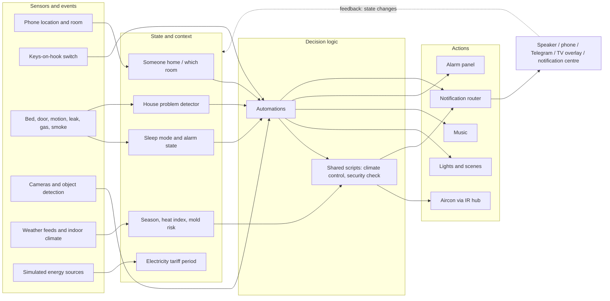

# 🏠 Casa De Ratton — Fully Automated Smart Home

---

## What This Is

Casa De Ratton is a fully autonomous smart home running on Home Assistant. It manages presence, climate, security, energy, media, and social automation without manual input. An AI persona named **JARVIS** handles all voice announcements and notifications, routing them to the right output — speaker, phone, Telegram, TV, or the Home Assistant notification centre — based on time, context, and occupancy state.

This document explains how the system works as a whole.

---

## Architecture at a Glance

Data flows left to right. Devices and external feeds produce raw readings; helpers and derived sensors turn them into house-level context (is anyone home, is the house asleep, how hot does it feel); automations decide what should happen; shared scripts or direct commands act on devices. **Every spoken or written message funnels through one notification router**, which is why that section matters for almost every other subsystem.

---

## How It Works

**🚶 Presence & Arrival**

The house has a single "someone is home" signal. It is true when a person is at home **or** the phone reports a known room inside the house, so it keeps working when GPS and Wi‑Fi disagree. The phone's room and zone are also turned into friendly text such as "Sleep", "At Work" or the room name.

Departure and arrival are not purely GPS-based. A **keys-on-hook switch** by the door is a key input:

- **Leaving:** when the house has been empty for 3 minutes and the keys are on the hook (and Home Assistant has been up for at least 5 minutes, to avoid false triggers after a restart), the house records the departure time, arms the alarm in away mode, and switches off the aircon, kettle, fans, lights and the laptop. Audible announcements and climate automation are turned off. An AI-written JARVIS departure message follows.
- **Returning:** two flows. When the keys are taken off the hook after more than 5 minutes away, the house records the return time, gathers a status snapshot (air quality, UPS, battery, backup age, time away), has the AI write a personalised welcome, sends it through the router and starts the TV box. Separately, when the person has left a work location for 18 minutes (only in the evening, and not in guest or cleaning mode), the house starts the aircon, sets the alarm to home mode, turns the fans on and runs a living-room scene.

Room-level tracking (Bluetooth proxies with Bermuda) drives speaker routing: the phone's room selects the nearest speaker, falling back to the living room.

---

**🌅 Morning Wake-Up**

Two automations split the morning:

1. **Wake-up music** fires at the configured alarm time — only if the bedroom door is closed, someone is home, and sleep mode is on. It waits (up to 30 seconds) for the bedroom Chromecast to be ready, then starts a shuffled playlist and ramps the volume up gently over 5 minutes.
2. **Morning transfer** fires when the bedroom door opens after the alarm time and the bed is empty. It waits for the phone to appear in the living room, sets the alarm to home mode, ends sleep mode, re-enables audible and Telegram notifications, runs a living-room scene, turns on fans, kettle and display, and plays the JARVIS **morning briefing** (security state, doors, leaks, internet, air quality, maintenance reminders, pending updates, device batteries and the day's calendar) through the router.

Going to bed is the mirror image. When the bed has been occupied for 30 seconds between 20:00 and 05:00, with the bedroom door closed and the living-room fan running, the house arms the alarm in night mode, stops media, turns off lights, fans, kettle and display, mutes audible notifications, switches sleep mode on and hands control to the aircon logic. A goodnight announcement plays at the configured bedtime.

---

**🌡️ Climate**

The bedroom aircon is controlled by a single shared piece of logic. It looks at the current season, the bedroom heat index and the humidity, and chooses *cool*, *dry* or *off*:

| Season | Cool when heat index ≥ | Dry when humidity ≥ | Dry heat-index window | Dry setpoint |
|---|---|---|---|---|
| Hot season | 29 | 75 % | 26–32 | 27 °C |
| Any other season | 27 | 68 % | 24–30 | 28 °C |

The cool setpoint is 26 °C unless a caller overrides it. Three flows use this logic:

- **Night climate:** 20:00–08:10 with the bedroom door closed, reacting to heat index, humidity and mold risk, and forcing the aircon off at 08:05.
- **Daytime check:** every 10 minutes while climate automation is enabled, someone is home and the living room is hot; it also turns the aircon off once the bedroom is cool enough.
- **Sleep and arrival** call it directly.

A custom season classifier has **four** values rather than simple wet/dry: high season (Nov–Mar), hot season (Apr to mid‑May), wet season, and monsoon peak (Sep–Oct). Only the hot season currently changes the aircon thresholds (see the notes at the end). Aircon runtime is tracked daily and monthly. Mold indicators, vapour-pressure deficit, heat index, rain prediction and wind classification are derived from local sensors plus weather services.

---

**💡 Lighting**

Lights adapt to presence, TV state, time and weather with no manual switching needed under normal operation. Adaptive Lighting handles colour temperature, shifting from warm at night to cool-white by day, and can be switched off for selected lights. Living-room scenes (sunset, purple/blue, zen, rain) are scripted. The living room responds to the active TV app: streaming apps switch to a movie scene, music apps to a calm scene, and turning the TV off restores a sunset scene by day or a purple/blue scene in the evening. Outdoor, porch, backyard and bedroom motion lights, kitchen ambient lighting and the camera night lights run on sun and motion automations.

---

**🔒 Security**

[Frigate NVR](https://frigate.video/) runs on a Proxmox container with object detection and publishes review events over MQTT. A single notifier handles Frigate reviews and garage/porch motion: it captures snapshots at the moment of detection, has an AI vision model describe the event and rate its importance, and sends one enriched notification (snapshot plus *View Clip* / *View Snapshot* buttons) through the router instead of raw motion alerts.

The alarm panel is armed away when leaving, in night mode at bedtime, and in home mode on return and wake-up. A **security check** runs when the house problem detector (water leak, smoke, gas, aircon leak) has been active for 30 seconds, or when the alarm triggers — unless alarm pause mode is on, and a watchdog warns if it is left on. The check analyses the garage and backyard camera snapshots with AI vision, posts them to Telegram, and then speaks a combined report of motion, door, leak and gas state. When nobody is home and the alarm is triggered, lights flash.

A **daily security summary** runs shortly before bedtime (with a 01:00 fallback), sends the last 24 hours of camera events to Google AI and posts a JARVIS-style report to the Telegram log channel. A weekly rollup follows the same pattern. Doors left open for 5 minutes trigger a reminder, suppressed during cleaning.

---

**🔔 Notifications**

Every message goes through one notification router that fans out in parallel to the channels enabled by on/off toggles:

- **Speaker (TTS)** — when audible notifications are on **and sleep mode is off**, or when the sender marks the message urgent. The speaker is chosen from the occupant's room (or the whole-house group when requested). Volume depends on the time of day — quieter between 23:00 and 07:00 — and the previous volume is restored afterwards. Pausing and resuming music around an announcement relies on Music Assistant rather than the announcement logic itself.
- **Phone** — push notification, with optional image and action buttons.
- **Telegram** — photo or message to the log channel.
- **TV overlay** — on-screen notification.
- **Persistent** — stored in the Home Assistant notification centre.

The **Awtrix** LED display is not part of the router; weather, rain forecast, now-playing, laundry timer and battery information are driven by their own automations. **Mastodon** posts use a separate path with their own toggle.

---

**🎵 Media**

[Music Assistant](https://music-assistant.io/) manages all speakers as a multiroom system. With follow-me music enabled and someone home, a change of room unjoins the whole-house group and moves the playback queue to that room's speaker; a second flow hands music between the living room and the phone. Voice commands cover "play music" (on the speaker nearest the phone), weather, traffic and water-tank level. The morning wake-up and the TV-driven scenes are the main automated media sequences.

---

**🚿 Bathroom**

Occupancy is tracked session by session. Opening the door or detecting motion starts a session and turns on the light. After 5 minutes a 10-minute timer starts; at 15 minutes in total the light flashes and **stays red** as a visual warning (there is no spoken or pushed alert). The session ends when the door has been closed for 10 seconds, or after 6 minutes without motion, which turns the light off and cancels the timers.

---

**🍳 Kitchen**

Kitchen timers use Home Assistant timers and voice commands, with a notification on completion. Kettle, rice-cooker and air-fryer routines cover appliances. A load cell under the LPG cylinder tracks level, consumption rate, days remaining and cost, and a low-gas alert announces when the cylinder drops below 5 % (not while the house is asleep). Water tank level, flow and cost are tracked as well, with a water-quality alert.

---

**🍽️ Meals**

Mealie, a self-hosted recipe manager, supplies **today's** planned meal to Home Assistant for dashboard display and JARVIS announcements.

---

**🧺 Laundry**

Laundry is calendar- and zone-driven. A laundry-day trigger announces and arms a helper; entering one of the laundry-shop zones while it is armed starts a 2-hour timer. When it finishes a pick-up reminder is sent, and the cycle closes when the occupant returns to that zone.

---

**🛠️ Utility Tracking**

A handful of background trackers keep tabs on things outside the house itself: days since the last pest control service, aircon and fan cleaning countdowns with reminders, internet outage start, end and duration, the cheapest 91/95 fuel prices among local stations, and the live position of the ISS.

---

**⚡ Energy**

The energy system is a **full simulation**, not metering. Household load is estimated from device power profiles. Solar (driven by sun elevation and cloud cover), a wind turbine (driven by wind and storm conditions), a battery and the grid are modelled together. The priority is: solar and wind feed the home first, surplus charges the battery (up to a charge limit), then the rest is exported; **grid import is whatever the other sources do not cover**.

Electricity is tracked against a time-of-use tariff: peak on weekdays 09:00–22:00, off-peak otherwise. Import is split into peak and off-peak daily, monthly and yearly totals, and cost, export revenue and net cost are derived from them. Water and gas are tracked separately.

---

**🌿 Nature & Social**

Bird detections from the garden microphone arrive over MQTT and accumulate in a daily list that resets at midnight. Each evening a summary is posted to the connected [Mastodon](https://social.nightdestiny.com/@house) account and a public [Telegram channel](https://t.me/live_phuket). Other scheduled posts cover rain statistics, freeze warnings, holidays and periodic AI-written status updates about the house. AI text generation tries Google AI first (with one retry), then a free OpenRouter model, then fixed fallback text.

---

**🧹 House Modes**

House cleaning mode and guest mode adjust automation behaviour while active — for example, arrival climate actions are skipped and door-open reminders are suppressed during cleaning. Cleaning day can be started from a calendar, cancelled from a notification or NFC tag, and ends when the doors are closed. A kitchen trash reminder rounds out the household helpers.

---

**🔧 System Health**

On every start, the AI produces a JARVIS "back online" message from the alarm state, UPS status, battery, last backup and the last internet outage. The house also detects whether a restart was a **core upgrade** by comparing the installed version with the last one seen, logs it, and records the new version. It does not reset helper toggles on restart.

A **health check runs every 6 hours**. It collects battery, solar, grid, fridge and environmental readings, flags unavailable or stuck devices from a fixed monitored list (cameras, leak, smoke, door and motion sensors, key power readings), compares values against 24-hour statistics, and posts one JARVIS-style report to the Telegram log channel. Self-healing logic watches the Frigate and Zigbee containers on Proxmox: it confirms the failure, announces it, and restarts the container (up to two attempts, with a 30-minute cooldown). Other monitors cover disk space, Zigbee availability, low voltage, curtain motors, Cloudflare and Home Assistant repair issues.

The recorder keeps 7 days of history in SQLite with an explicit include list. The configuration is backed up to a GitHub repository, and tagged releases include a changelog and a zipped config archive.

